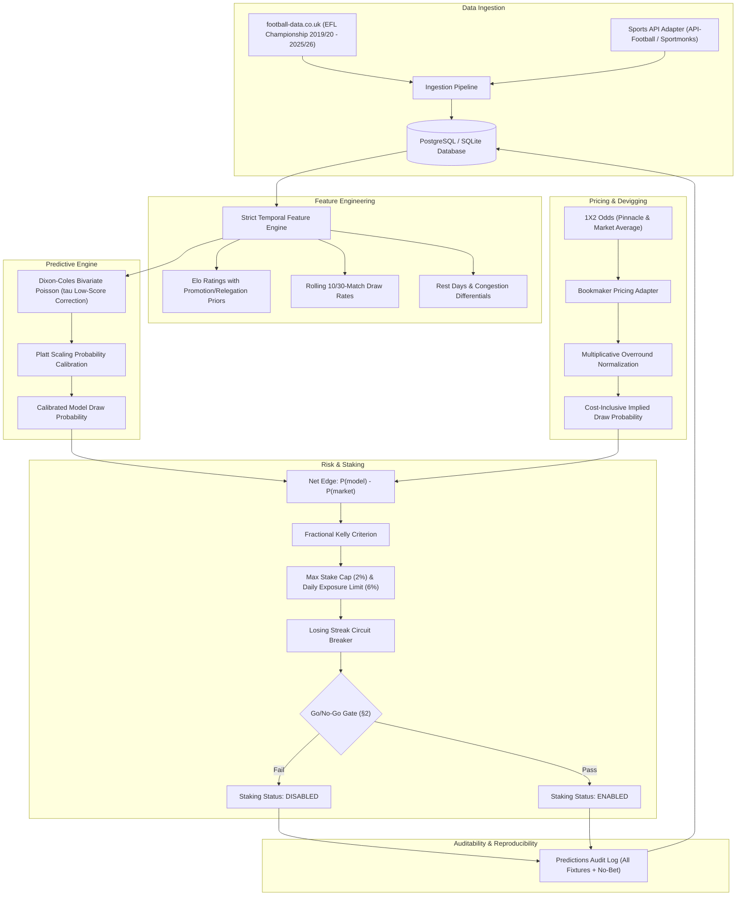

# Skynet Championship: EFL Draw Predictor

**"Skynet Championship"** is a specialized predictive modeling and value-betting system engineered exclusively for the English Football League (EFL) Championship. It identifies draw scenarios and calculates betting value by comparing model-generated probabilities against vig-adjusted market odds.

Compliant with **System Architecture & Business Requirements Document (BRD) v4.6 - Final**.

---

## 1. System Architecture



---

## 2. Core Modules

| Module | Location | Description |
|---|---|---|
| **Database Schema** | [`skynet/db/schema.py`](skynet/db/schema.py) | SQLAlchemy models: `matches`, `historical_odds`, `model_versions`, `predictions_audit`. |
| **Pricing Adapter** | [`skynet/pricing/bookmaker.py`](skynet/pricing/bookmaker.py) | Overround devigging, vig-adjusted probability calculation, unadjusted edge flagging. |
| **Feature Engine** | [`skynet/features/engineering.py`](skynet/features/engineering.py) | Temporal leak-free feature pipeline, rolling draw rates, rest days. |
| **Elo & Churn** | [`skynet/features/elo.py`](skynet/features/elo.py), [`churn.py`](skynet/features/churn.py) | Churn priors (+60 for relegated PL teams, -60 for promoted L1 teams), seasonal mean reversion. |
| **Dixon-Coles Model** | [`skynet/models/dixon_coles.py`](skynet/models/dixon_coles.py) | Bivariate Poisson with $\tau_{\lambda, \mu}$ adjustment and time decay ($\xi=0.0019$). |
| **Calibration** | [`skynet/models/calibration.py`](skynet/models/calibration.py) | Walk-forward Platt scaling, Cox calibration slope/intercept, Brier score, ECE. |
| **Staking Engine** | [`skynet/staking/kelly.py`](skynet/staking/kelly.py) | Fractional Kelly ($0.25\times$), 2% max stake, 6% daily exposure, loss streak breakers. |
| **Go/No-Go Gate** | [`skynet/staking/gate.py`](skynet/staking/gate.py) | Institutional gate: $\ge 150$ bets, $\text{ROI} > 0$, $\text{CLV} > 0$, Cox slope $\in [0.8, 1.2]$, intercept $\in [\pm 0.05]$. |
| **Backtester** | [`skynet/backtest/engine.py`](skynet/backtest/engine.py) | Walk-forward evaluation across 5 Championship seasons (`2122`–`2526`). |
| **CLI** | [`skynet/cli.py`](skynet/cli.py) | Unified command-line interface. |

---

## 3. Quick Start & CLI Usage

### Setup Virtual Environment
```bash
python3 -m venv .venv
source .venv/bin/activate
pip install -r requirements.txt
```

### 1. Ingest EFL Championship Historical Data
Downloads and parses seasons 2019/20 through 2025/26 from football-data.co.uk into SQLite / PostgreSQL:
```bash
python3 -m skynet.cli ingest
```

### 2. Run Walk-Forward Backtesting Engine
Executes walk-forward backtesting across all 5 completed historical seasons (`2122`–`2526`):
```bash
python3 -m skynet.cli backtest --threshold 0.31 --edge 0.03 --kelly 0.25
```

### 3. Predict Fixture & Calculate Value
Calculates draw probability, devigged market odds, net edge, and suggested fractional Kelly stake:
```bash
python3 -m skynet.cli predict \
  --home "Leeds" \
  --away "Sunderland" \
  --draw-odds 3.35 \
  --home-odds 2.10 \
  --away-odds 3.60 \
  --venue "PINNACLE"
```

### 4. Inspect Predictions Audit Log
Inspects the permanent audit records including "NO_BET" fixtures:
```bash
python3 -m skynet.cli audit --limit 20
```

---

## 4. Streamlit Web Dashboard (Phase 2)

Launch the interactive dashboard locally:
```bash
streamlit run app.py
```

Features included:
- **Executive Overview & Governance**: Key KPIs (Total Matches, Bets, Win Rate, PnL, ROI, CLV, Max Drawdown) and §2 Go/No-Go Gate status banner.
- **Financial Analytics**: Cumulative PnL curves, seasonal ROI tables, and monthly PnL distributions.
- **Model Calibration & Cox**: Reliability diagrams, Cox calibration slopes/intercepts, and Brier score tracking.
- **Audit Trail Explorer**: Filterable records for all fixtures (including No-Bet outcomes).
- **Interactive Match Predictor**: Live 1X2 odds devigging, draw value assessment, and score probability heatmaps.

Deploy to Streamlit Community Cloud in 1-click:
[](https://share.streamlit.io/deploy?repository=olumakin/kekere&branch=main&mainModule=app.py)

---

## 5. Running Tests

The test suite validates pricing devigging, Elo churn priors, Dixon-Coles likelihood & Poisson matrix calculation, Platt and Cox calibration, Fractional Kelly staking, and 100% prediction reproducibility from serialized artifacts:

```bash
pytest -v
```

